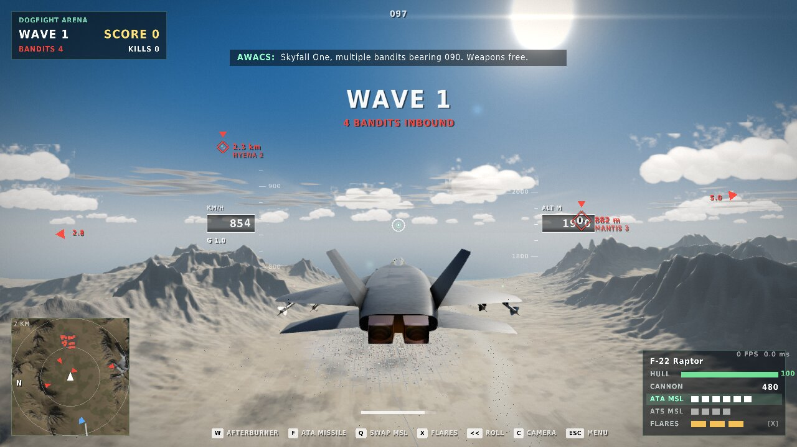
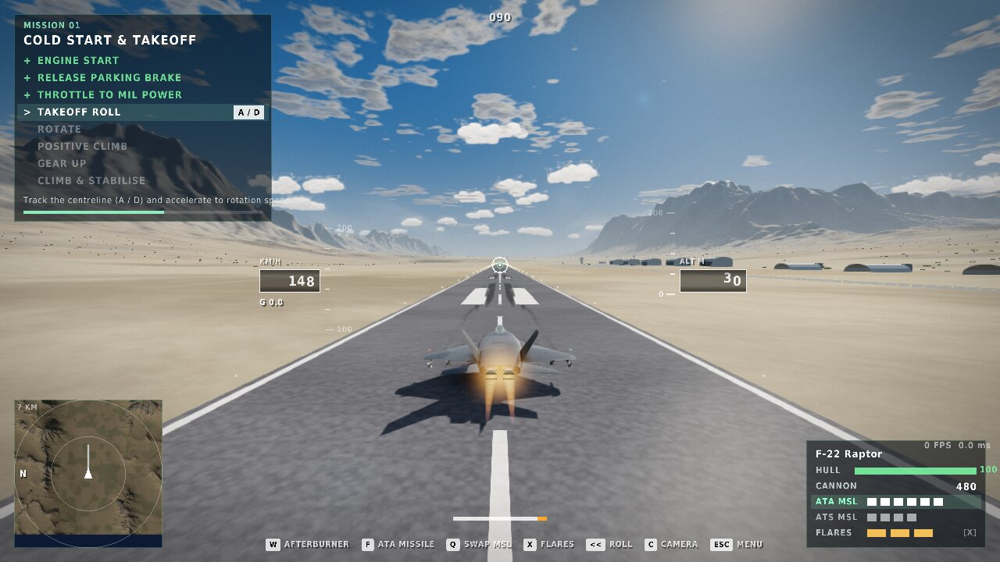
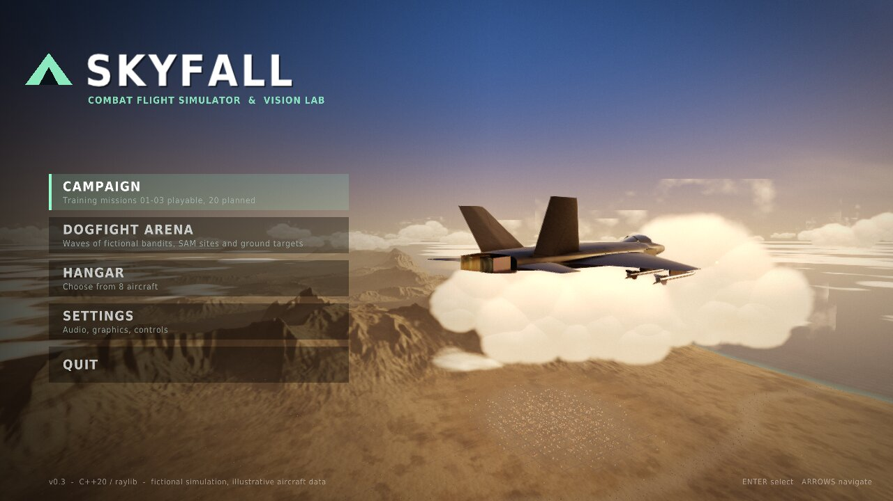

# SKYFALL — Real-Time Combat Flight Simulator & Computer Vision Laboratory

A native **C++20 / raylib** combat flight game and simulation sandbox built for macOS first
(Apple Clang, CMake, 8 GB MacBook Air class hardware), portable to Linux and Windows.

It is inspired by the *feel* of modern jet gameplay (third-person chase camera, missile locks,
flares, explosions, a big battlefield landscape) while keeping the engineering honest: a
deterministic fixed-step flight model with real lift/drag/thrust equations, unit tests, measured
frame-time telemetry and clearly labelled approximations. **Everything in it is original**: no
copyrighted models, textures, sounds or code from commercial games.


| | |
|---|---|
|  |  |
|  |  |
|  |  |

> Screenshots are captured from the running executable (`skyfall --capture`) — on a Linux
> container with Mesa's software rasteriser, so they show the real renderer output, but not
> macOS performance. See [docs/BENCHMARKS.md](docs/BENCHMARKS.md).

## What you can do in this build (v0.3)

* **Mission 01 — Cold Start & Takeoff** (guided, telemetry-driven checklist): engine start,
  parking brake, throttle to MIL, takeoff roll, rotate, positive climb, gear up, stabilise.
  Steps only complete when the aircraft state satisfies them — never on a timer.
  When it is complete, press **Enter** and the same flight turns into a dogfight.
* **Dogfight Arena**: endless waves of fictional AI bandits (3 skill tiers), two AI wingmen,
  radar lock + guided missiles (proportional navigation), cannon with tracers, flares that can
  decoy missiles, SAM sites, AAA, tanks, trucks, radar and bunkers in a fictional town,
  kill feed, score, respawn.
* **Three cameras** (`C`): cockpit with live MFDs and a conformal HUD, smoothed chase camera,
  external orbit camera (~5 m from the airframe, auto-framed).
* **Hangar** with eight data-driven aircraft slots (F-22, F-35, Rafale, Su-57, Su-35,
  MiG-29, Su-30, F-16). The F-22-inspired jet is the tuned, playable one; the others are used by
  the AI or are roadmap items. All meshes are original, procedurally built silhouettes.
* **Settings** saved to `~/Library/Application Support/SKYFALL/settings.ini`: audio buses
  (master / music / engine / radio / effects, **in-game music OFF by default** so your own music
  keeps playing), quality, time of day, FOV, camera shake, G-effects, invert pitch, handling
  (Assisted / Simulation), sensitivity, captions.

## Build & run (macOS)

```bash
xcode-select --install          # only if the Command Line Tools are missing
brew install cmake raylib       # raylib optional: CMake downloads 5.5 automatically if absent
cd SKYFALL
cmake -S . -B build -DCMAKE_BUILD_TYPE=Release
cmake --build build --parallel 2
ctest --test-dir build --output-on-failure
./build/skyfall
```

Or simply `./scripts/build_mac.sh` (configure + build + test + launch; it also works around a
Command Line Tools linker/SDK mismatch by falling back to an older installed SDK). Afterwards,
`./scripts/run.sh` rebuilds incrementally and launches in seconds. Every run writes
`logs/skyfall.log` (GPU info, warnings, and a frame-time summary on exit).

Useful flags: `--mode arena` / `--mode m01` (skip the menu), `--size 1440x900`, `--windowed`,
`--quality 0|1|2`, `--bench 30` (writes `benchmarks/benchmark.json` + `frame_times.csv`),
`--capture shots/` (scripted screenshots from the real renderer).

## Controls

| Key | Action | Key | Action |
|---|---|---|---|
| `W` / `S` | throttle up / down (full = afterburner) | `E` | engine start |
| `↓` / `↑` | pitch up / down (stick back = ↓) | `B` | parking brake |
| `←` / `→` | roll | `Left Ctrl` (hold) | wheel brakes / air brake |
| `A` / `D` | yaw / nosewheel steering | `G` | landing gear |
| `Space` / left mouse | cannon | `F` | missile (lock first) |
| `X` | flares | `T` / `Tab` | cycle target |
| `Q` / `1` / `2` | swap / select ATA (air-to-air) or ATS (air-to-surface) missiles | double-tap `←`/`→` | aileron roll |
| `U` | HUD style (minimal / full) | `Cmd+Q` | quit immediately |
| `C` | camera: cockpit → chase → external | right-drag, `I J K L` | look / orbit, wheel = zoom |
| `R` | reset / respawn | `H` | help overlay |
| `F3` | telemetry (p50/p95/p99 frame times, physics) | `F5` | time of day |
| `F12` | screenshot | `Esc` / `P` | pause menu (Esc again resumes) |

Gamepad: left stick fly, triggers throttle, RB cannon, LB missile, A flares, B target,
X gear, Y camera, d-pad yaw.

## Engineering highlights

* `src/sim` — raylib-free physics: ISA atmosphere, lift `L = ½ρV²S·CL(α)`, drag
  `D = ½ρV²S·CD(α)`, spooling engine + afterburner with density lapse, gravity, ground reaction,
  brakes and tyre friction, touchdown/crash rules, quaternion attitude with an assisted
  fly-by-wire (G-command pitch, AoA limiter). Semi-implicit Euler at a fixed **120 Hz** with a
  bounded accumulator (no spiral of death). Bit-for-bit deterministic (tested).
* `src/combat` — deterministic battle sandbox: AI pilots, lock-on, PN missiles, flares, guns,
  ground units, events.
* `src/mission` — reusable mission FSM driven by telemetry predicates.
* `src/render` — HDR pipeline: analytic sky, height fog shared by every shader, procedural
  chunked terrain with LOD + skirts + far ring, farmland/forest/rock/snow shading, cloud
  shadows, sea with depth colour and sun glitter, two-sheet cloud layer + billboard cumulus,
  PBR-lite aircraft with sky reflections and camouflage, afterburner plumes, ribbon smoke trails,
  explosions, flares, tracers, bloom + ACES tone mapping, lens flare, G-blackout.
* `src/ui` — Battlefield-style HUD (markers, lock box, gun pipper, minimap, kill feed, warnings),
  virtual cockpit with five live displays and a conformal HUD in the combiner.
* `src/audio` — fully procedural sound (no sample files).
* `tests/` — 24 deterministic tests (`ctest`).

Read more: [Architecture](docs/ARCHITECTURE.md) · [Physics](docs/PHYSICS.md) ·
[Aircraft data](docs/AIRCRAFT.md) · [Roadmap & checklist](docs/ROADMAP.md) ·
[Benchmarks](docs/BENCHMARKS.md) · [Interview notes](docs/INTERVIEW_NOTES.md)

## Honest limits

This is a prototype, not a certified simulator and not AAA art. Aircraft performance values are
public rounded figures plus tuned illustrative aerodynamics; rotational dynamics use a
documented rate-command approximation rather than a full moment model; terrain is fictional and
procedural. OpenGL is deprecated on macOS; a Metal renderer is a roadmap item. The Computer
Vision Laboratory is planned, not implemented yet.

## License

MIT (see `LICENSE`). Fonts are loaded from your operating system at runtime and are not
redistributed.
