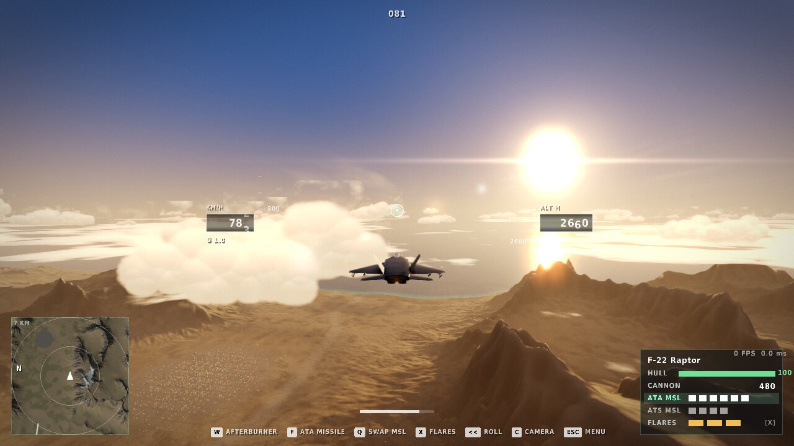
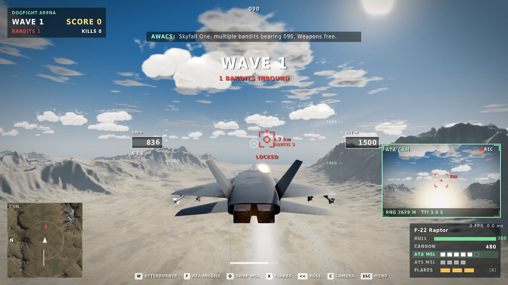
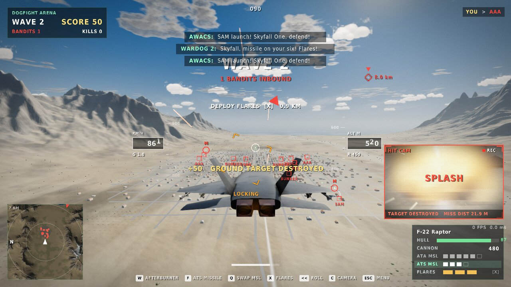
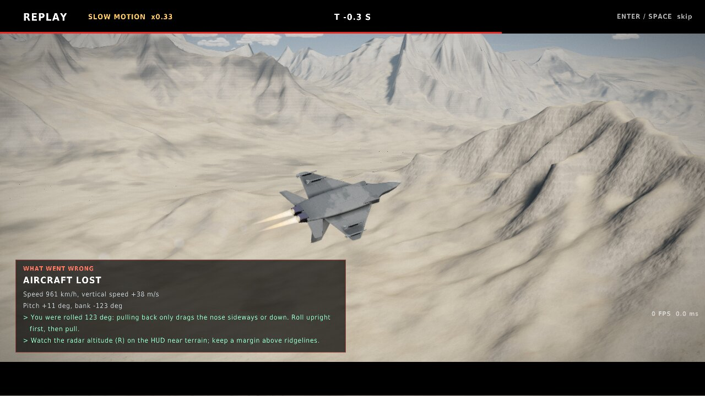
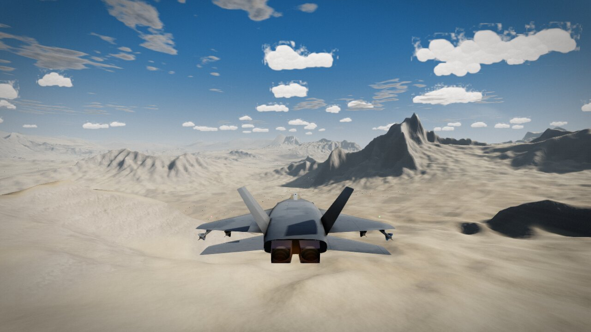
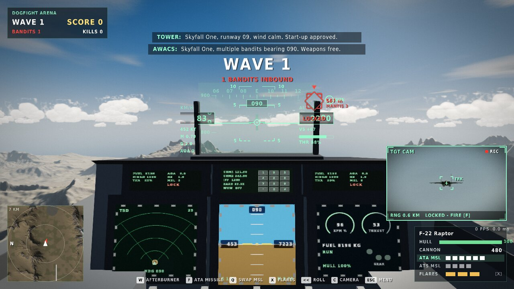
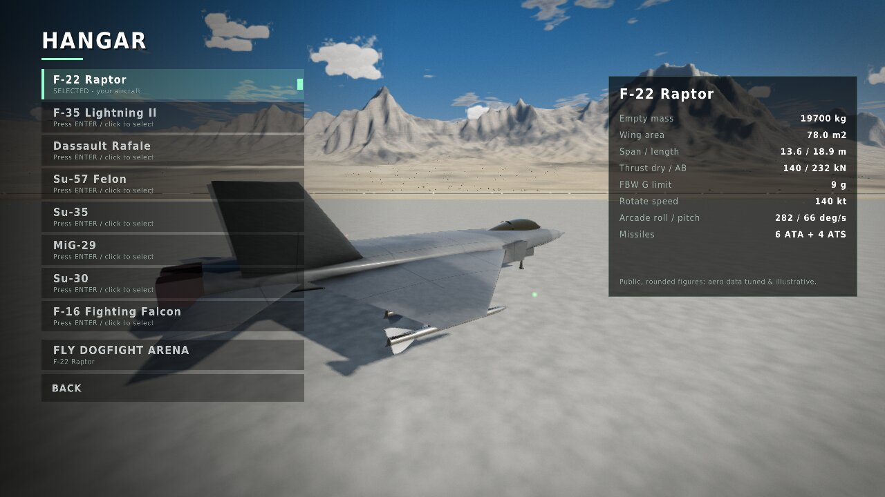
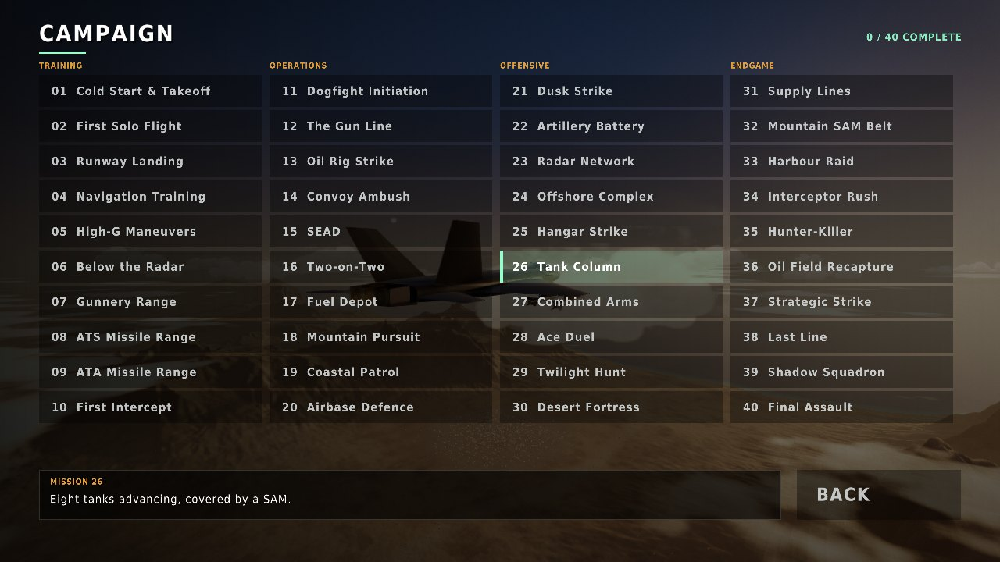
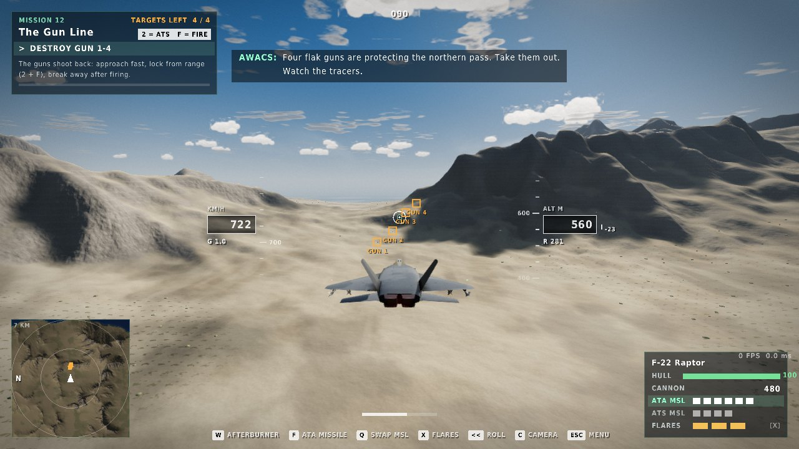

# SKYFALL — Real-Time Combat Flight Simulator & Computer Vision Laboratory

[](https://github.com/Singhsh01/SKYFALL/actions/workflows/build.yml)
[](https://github.com/Singhsh01/SKYFALL/actions/workflows/pages.yml)

### ▶ [Play in your browser](https://singhsh01.github.io/SKYFALL/) &nbsp;·&nbsp; [straight into the Dogfight Arena](https://singhsh01.github.io/SKYFALL/?mode=arena)

Runs instantly in Chrome, Edge, Firefox or Safari (WebGL 2): no install, the game runs inside the
browser's sandbox. Click **Play**; the world is generated in a few seconds. Keyboard required.

Prefer the native app (higher frame rate, full window)? [Download for macOS](https://github.com/Singhsh01/SKYFALL/releases/latest/download/SKYFALL-macOS.zip)
— Apple Silicon and Intel, macOS 12+. Unzip, then right-click **Play-SKYFALL.command → Open**
(the build is not notarised, so macOS asks once).

A native **C++20 / raylib** combat flight game and simulation sandbox built for macOS first
(Apple Clang, CMake, 8 GB MacBook Air class hardware), portable to Linux and Windows.

It is inspired by the *feel* of modern jet gameplay (third-person chase camera, missile locks,
flares, explosions, a big battlefield landscape) while keeping the engineering honest: a
deterministic fixed-step flight model with real lift/drag/thrust equations, unit tests, measured
frame-time telemetry and clearly labelled approximations. **Everything in it is original**: no
copyrighted models, textures, sounds or code from commercial games.



| | |
|---|---|
|  |  |
|  |  |
|  |  |
|  |  |

> Screenshots are captured from the running executable (`skyfall --capture`) on a Linux
> container with Mesa's software rasteriser: they show the real renderer output, not macOS
> performance. Measured on a MacBook Air (v0.3 build): 66 fps mean, p95 20 ms at 1680x1050 High.
> See [docs/BENCHMARKS.md](docs/BENCHMARKS.md).

## What you can do in this build (v0.5)

* **All eight aircraft are flyable** (Hangar → select → FLY): F-22, F-35, Rafale, Su-57, Su-35,
  MiG-29, Su-30, F-16. Each has its own roll/pitch rates and missile load; the selection is used
  by the Campaign and the Dogfight Arena and is saved.
* **Arcade handling (default)** — Battlefield-style: the flight path follows the nose, hard turns
  bleed energy, every jet has enough afterburner thrust to climb out of a low dive.
  **Double-tap ← / →** for an aileron roll. Assisted and Simulation handling remain in Settings.
* **ATA and ATS missiles** (`Q` swap, `1` / `2` select, `F` fire): air-to-air locks aircraft,
  air-to-surface locks ground targets and has a larger blast.
* **Missile / target camera** — a picture-in-picture sensor feed beside the weapons panel:
  `TGT CAM` / `TGT POD` while locking (zoomed, with a track box), `ATA CAM` / `ATS CAM` riding behind
  your missile with range and time-to-impact, then a 2.8 s `HIT CAM` hold on the impact with the
  result (`SPLASH`, `HIT`, `MISSED`) and the measured miss distance.
* **Crash & shoot-down replay** — when you are lost, the last ~5 s are replayed from side and
  ground observers, in slow motion around the impact, with a *What went wrong* analysis built
  from recorded telemetry (bank, dive angle and pull-out height, PULL UP warning lead time,
  missile warning vs. flares, sink rate at touchdown…). `Enter` / `Space` skips.
* **Rolling gauges** — airspeed (km/h) and altitude (m) are odometer-style rolling drums with
  moving tapes, in both the minimal and the full HUD (`U`).
* **Desert battlefield** — eroded arid mountains (procedural noise shaped by a deterministic
  hydraulic-erosion simulation), dry river bed with palms, desert town, coast to the east.
* **40-mission campaign** (all unlocked, progress saved): training (takeoff, solo flight, landing,
  navigation, high-g, low-level, gunnery / ATS / ATA ranges), then strikes and air battles across
  the map: gun lines (GUN 1-4), offshore oil rigs, convoys, SAM sites and radars, fuel depots,
  hangars, command posts, patrol boats, artillery batteries, escalating fighter waves and a final
  assault that ends with a landing at home. Objective targets are marked in orange on the HUD and
  minimap with live "targets left" counters; friendly assets you must protect are blue.
  Missions 04-40 are data in `src/mission/Campaign.cpp`, and every one is played through by the tests.
* **Dogfight Arena**: endless waves of AI bandits with wingmen, SAM sites, AAA flak and a town garrison.
* **Steady frame rate**: dynamic resolution lowers the 3D resolution in 10 % steps when frames drop
  below ~55 fps and raises it again when there is headroom (Settings → Dynamic resolution; the HUD
  stays sharp). `F3` shows simulation and HUD CPU time per frame.

## Browser version (WebAssembly)

The same C++ code compiles to WebAssembly with Emscripten; raylib targets WebGL 2 (OpenGL ES 3.0)
and the GLSL 3.30 shaders are converted to GLSL ES 3.00 at load time (`src/render/ShaderLoad.hpp`).
The terrain build and light bakes run single-threaded in the browser (multi-threaded natively), so
world generation takes a few seconds longer. Settings are not saved between browser sessions.
`.github/workflows/pages.yml` builds and publishes it to GitHub Pages on every push.

```bash
./scripts/build_web.sh          # needs Emscripten (brew install emscripten); serves http://localhost:8000
```

## Build & run (macOS)

```bash
xcode-select --install          # only if the Command Line Tools are missing
brew install cmake raylib       # raylib optional: CMake downloads 5.5 automatically if absent
cd SKYFALL
cmake -S . -B build -DCMAKE_BUILD_TYPE=Release
cmake --build build --parallel 2
ctest --test-dir build --output-on-failure
./build/skyfall
```

Or simply `./scripts/build_mac.sh` (configure + build + test + launch; it also works around a
Command Line Tools linker/SDK mismatch by falling back to an older installed SDK). Afterwards,
`./scripts/run.sh` rebuilds incrementally and launches in seconds. Every run writes
`logs/skyfall.log` (GPU info, warnings, and a frame-time summary on exit).

Useful flags: `--mode arena` / `--mode m01` (skip the menu), `--size 1440x900`, `--windowed`,
`--quality 0|1|2`, `--bench 30` (writes `benchmarks/benchmark.json` + `frame_times.csv`),
`--capture shots/` (scripted screenshots from the real renderer).

## Controls

| Key | Action | Key | Action |
|---|---|---|---|
| `W` / `S` | throttle up / down (full = afterburner) | `E` | engine start |
| `↓` / `↑` | pitch up / down (stick back = ↓) | `B` | parking brake |
| `←` / `→` | roll | `Left Ctrl` (hold) | wheel brakes / air brake |
| `A` / `D` | yaw / nosewheel steering | `G` | landing gear |
| `Space` / left mouse | cannon | `F` | missile (lock first) |
| `X` | flares | `T` / `Tab` | cycle target |
| `Q` / `1` / `2` | swap / select ATA (air-to-air) or ATS (air-to-surface) missiles | double-tap `←`/`→` | aileron roll |
| `Enter` / `Space` | skip the crash replay | | |
| `U` | HUD style (minimal / full) | `Cmd+Q` | quit immediately |
| `C` | camera: cockpit → chase → external | right-drag, `I J K L` | look / orbit, wheel = zoom |
| `R` | reset / respawn | `H` | help overlay |
| `F3` | telemetry (p50/p95/p99 frame times, physics) | `F5` | time of day |
| `F12` | screenshot | `Esc` / `P` | pause menu (Esc again resumes) |

Gamepad: left stick fly, triggers throttle, RB cannon, LB missile, A flares, B target,
X gear, Y camera, d-pad yaw.

## Engineering highlights

* `src/sim` — raylib-free physics: ISA atmosphere, lift `L = ½ρV²S·CL(α)`, drag
  `D = ½ρV²S·CD(α)`, spooling engine + afterburner with density lapse, gravity, ground reaction,
  brakes and tyre friction, touchdown/crash rules, quaternion attitude with an assisted
  fly-by-wire (G-command pitch, AoA limiter). Semi-implicit Euler at a fixed **120 Hz** with a
  bounded accumulator (no spiral of death). Bit-for-bit deterministic (tested).
* `src/combat` — deterministic battle sandbox: AI pilots, lock-on, PN missiles, flares, guns,
  ground units, events.
* `src/mission` — reusable mission FSM driven by telemetry predicates.
* `src/sim/Terrain` — procedural heightfield + **particle hydraulic erosion** (700k droplets,
  deterministic) on a 2049² grid (15.6 m); physics and every mesh sample the same grid.
* `src/render` — HDR pipeline: analytic sky, height fog shared by every shader; terrain with
  three LODs (15.6 m chunks built lazily near the camera), a 2048² terrain-data texture with
  per-pixel normals, horizon-based ambient occlusion and **soft sun shadows baked by marching the
  heightfield** (multi-threaded, ~0.2 s, rebaked on time-of-day change); desert material shader
  (strata, sediment in gullies, desert pavement, scrub); sea with depth colour; cumulus sprites
  with baked shading; sun shadow map for aircraft; aircraft with airfoil-section wings,
  **voxel-baked per-vertex ambient occlusion** and a clear-coat paint BRDF (GGX + Smith);
  picture-in-picture second view; afterburners, smoke, explosions, flares, tracers, bloom + ACES.
* `src/ui` — Battlefield-style HUD (markers, lock box, gun pipper, minimap, kill feed, warnings),
  virtual cockpit with five live displays and a conformal HUD in the combiner.
* `src/audio` — fully procedural sound (no sample files).
* `src/telemetry/Replay` — 30 Hz flight recorder and crash/shoot-down analysis.
* `tests/` — 31 deterministic tests (`ctest`).

Read more: [Architecture](docs/ARCHITECTURE.md) · [Physics](docs/PHYSICS.md) ·
[Aircraft data](docs/AIRCRAFT.md) · [Roadmap & checklist](docs/ROADMAP.md) ·
[Benchmarks](docs/BENCHMARKS.md) · [Interview notes](docs/INTERVIEW_NOTES.md)

## Honest limits

This is a prototype, not a certified simulator and not AAA art. Aircraft performance values are
public rounded figures plus tuned illustrative aerodynamics; rotational dynamics use a
documented rate-command approximation rather than a full moment model; terrain is fictional and
procedural and fictional. Aircraft are original procedural meshes (not licensed models), so they
are clean silhouettes rather than photoreal assets. OpenGL is deprecated on macOS; a Metal renderer
is a roadmap item. The Computer
Vision Laboratory is planned, not implemented yet.

## License

MIT (see `LICENSE`). Fonts are loaded from your operating system at runtime and are not
redistributed.
