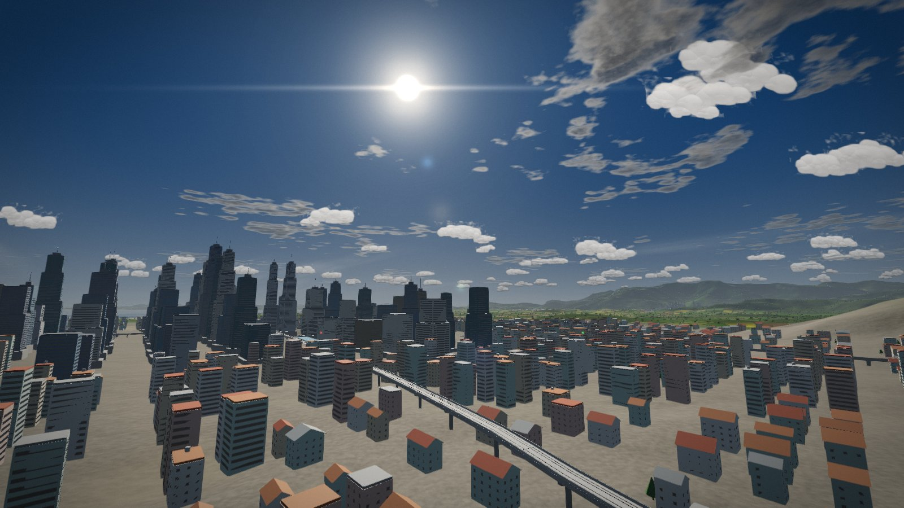
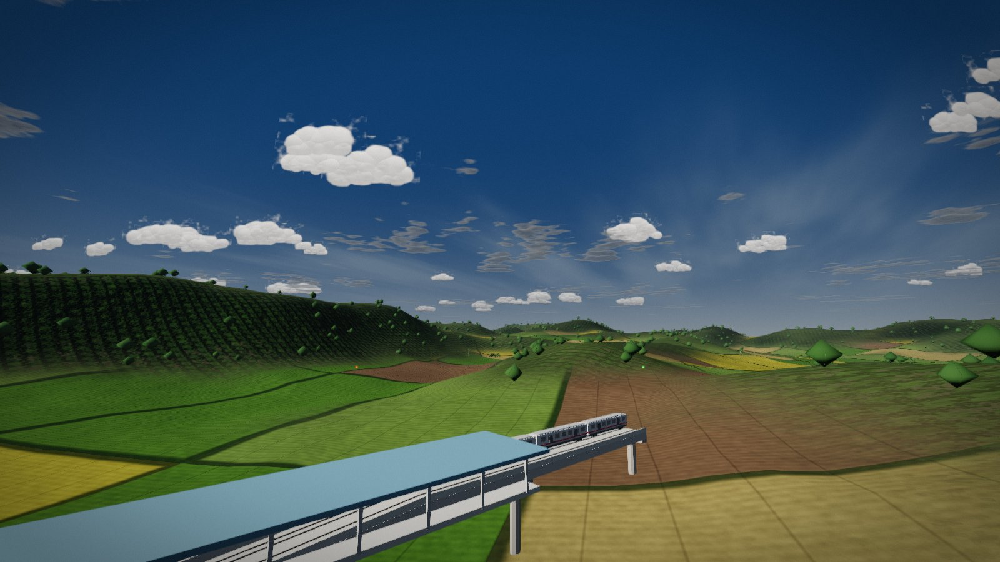
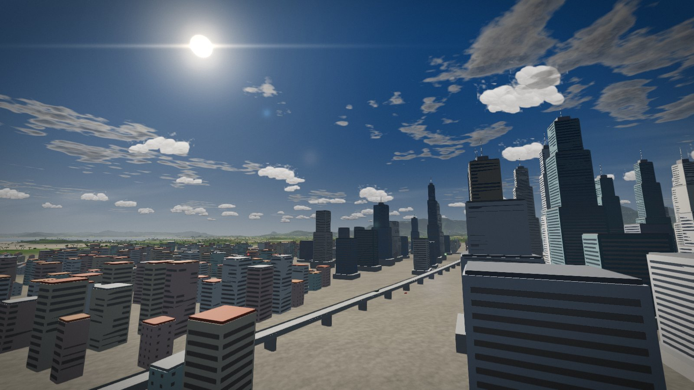
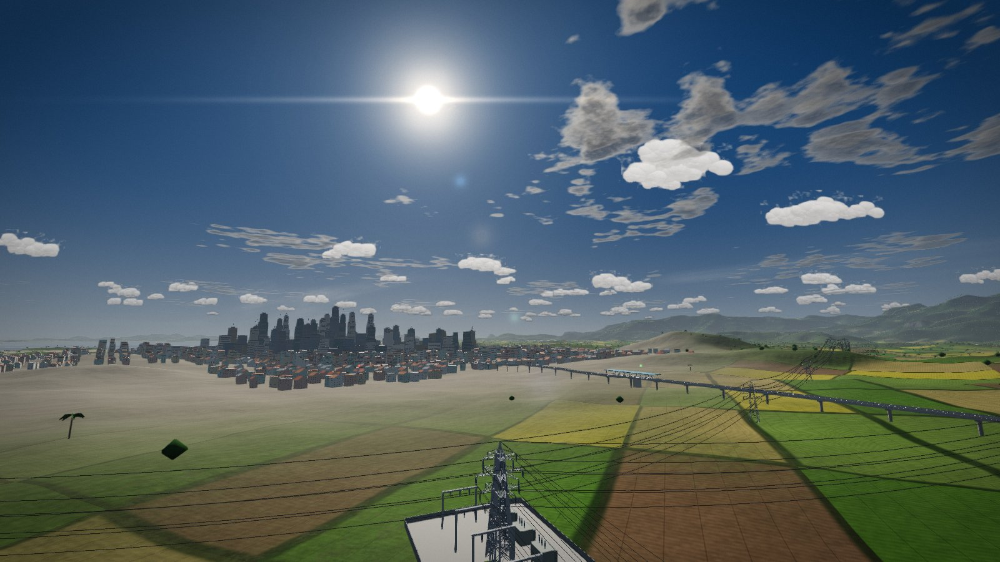
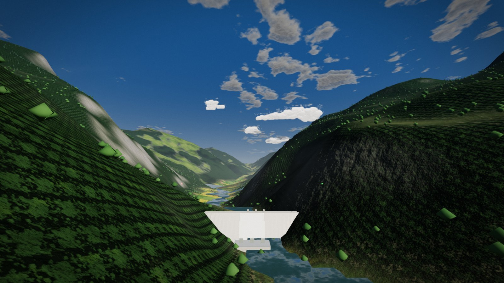
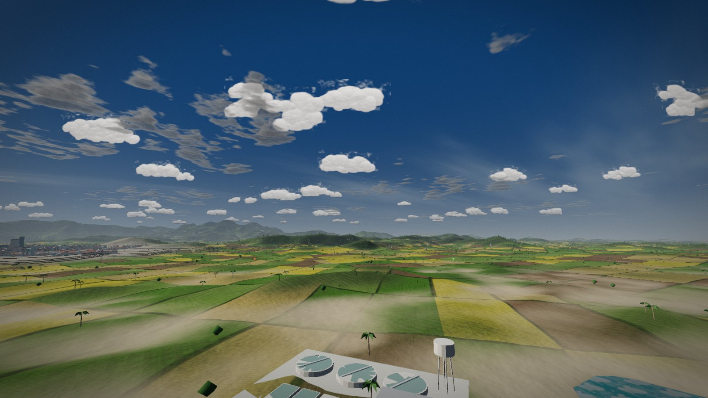
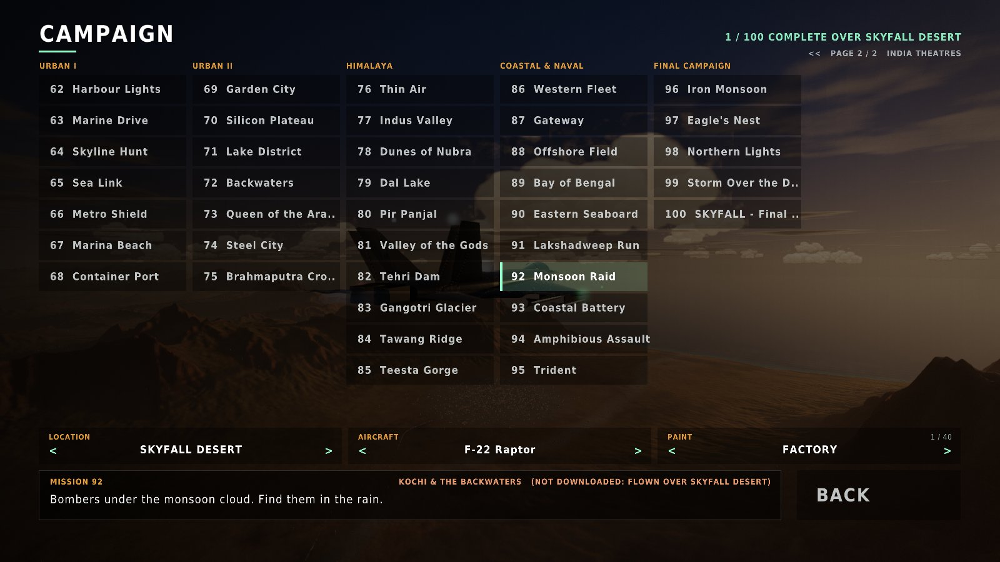
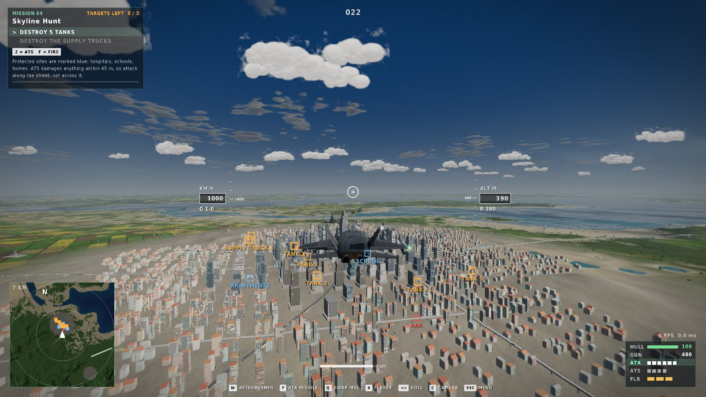
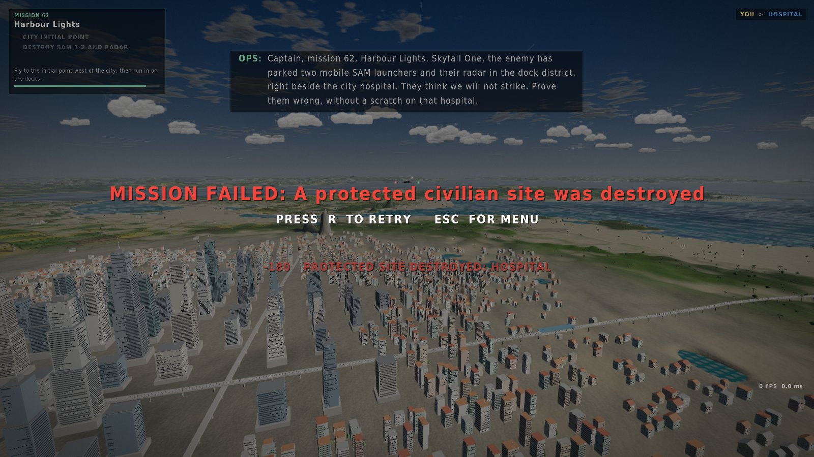
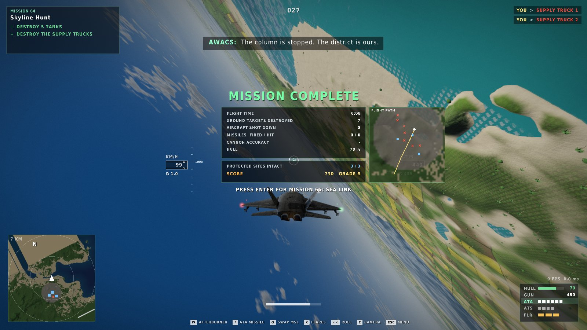

# SKYFALL v1.1 — India expansion, 100-mission campaign, chase camera, destruction

This page describes what v1.1 adds, how it was tested, and what it does **not** do yet. Screenshots
of Indian locations below were taken on *stand-in terrain* (a shipped map with the Indian
location's climate, rivers and city size, see "Testing without the Indian maps"), because the
elevation servers are not reachable from the build machine. Your downloaded maps will look different.

| | |
|---|---|
|  |  |
|  |  |
|  |  |
|  |  |
|  |  |

## World locations (15 Indian maps)

Leh & the Indus (Ladakh), Nubra, Kashmir Valley, Gangotri & Garhwal, Kullu-Manali (Himachal),
Tehri & the Bhagirathi (Uttarakhand), Tawang, Gangtok & East Sikkim, Brahmaputra & Guwahati, Kochi &
the backwaters, Chennai, Bengaluru, Visakhapatnam, Munnar & the Western Ghats, Mumbai. Each is a
32 x 32 km map downloaded in WORLD LOCATIONS like the others and usable in Free Flight, the Dogfight
Arena, the campaign and (except Ladakh, Nubra and Gangotri, which are too high for the Academy's
training heights) the Training Academy.

* **Climate**: Ladakh and Nubra use a new cold high-desert biome (grey scree, bare slopes, green
  poplar oases on the valley floors); the Himalayan maps have their snow and tree lines; the south
  is tropical.
* **Rivers and lakes** from the elevation itself: pits are filled, every cell drains to its
  steepest neighbour, and where enough area drains through a cell there is a river, wider the
  more it carries. Valleys crossing the map edge bring in their river from outside. Lakes and the
  Kochi backwaters fill everything below a level. Inland water is real water for physics,
  crashes and placement.
* **Cities by density** (`urban` 0-3): Mumbai, Chennai and Bengaluru get a metropolis (city
  radius 1.65 km instead of 0.75 km, two satellite cities, up to ten towns); the downtown has one
  tower per block, 45-300 m tall, glass or concrete, with set-backs, podiums, rooftop plant rooms
  and masts with obstruction lights; mid-rise apartment blocks around it. Generated towns and
  cities sit on paved ground (no fields under the houses).
* **Region-specific vegetation**: coconut palms on the low coast of Mumbai, Kochi, Chennai and
  Visakhapatnam; a broadleaf belt (chinar, walnut, orchards, subtropical forest) below the
  conifers in Kashmir, Himachal, Uttarakhand, Sikkim and Tawang; broadleaf forest in Assam.

## Infrastructure (every map, generated from the terrain)

* **Power grid**: a trunk line from the hydro dam's powerhouse (or a plant by the industrial zone,
  or the map edge) to the city substation, branches to a substation at each town. Lattice pylons
  every ~330 m (legs, bracing, three cross-arms with insulator strings, earth-wire peak) with six
  sagging conductors and an earth wire per span. Lines detour around towns and the runway
  approach and climb-out funnels, never stand in water or on cliffs, and end at a bay or lake
  (spans over 1.1 km are not built). The wires are drawn as one-pixel lines, darkened against the
  sky and faded out between 1.3 and 2.6 km so they never shimmer.
* **Hydro dam**: on maps with rivers, a concrete gravity dam across the narrowest steep-sided
  gorge (vertical upstream face, sloped downstream face, crest road with parapets, a white-water
  spillway with gate piers) and its powerhouse at the foot. The reservoir behind it is *not*
  flooded (see limitations).
* **Water works**: clarifier tanks with water and their bridges, filter beds, a treatment hall and
  an elevated tank beside the river or the sea near the city and the largest town.
* **Elevated metro** (metropolis maps and Kochi / Guwahati-size cities): a box-girder viaduct on
  single columns with hammerhead caps, two tracks, a station with platforms and canopy every
  ~1.3 km and at both termini, and 2-5 four-car trains shuttling with station stops (a pure
  function of time, like the road traffic).
* **Expressway flyovers**: elevated roads across the city that ramp down at both ends; the road
  traffic drives over them.
* **Roads and railways across rivers** are now bridges (the deck clears the water with short
  ramps); a railway that would need a viaduct more than ~95 m high in the mountains is not built,
  and mountain roads take steeper grades rather than 200 m viaducts.
* Existing: towns, ports and container yards, industrial zones, military compounds and forward
  operating bases, wind farms.

## The campaign: 100 missions

Missions 1-61 are unchanged (any location, progress kept, old saves load). Missions 62-100 are
the India theatres, on page 2 of the campaign screen. Each is written for its Indian location and
is flown there when that map is downloaded; otherwise it is flown over the campaign location you
chose, fitted to its terrain like the rest (the briefing panel says which).

**Rules of engagement.** Every target that can be destroyed is military: armour, air defences,
guns, launchers, command posts, helicopters, warships, airbases. Hospitals, schools, homes,
stations, the monastery and the dam control room are **protected sites**: marked blue on the HUD
and the map, never a target. A missile damages everything within 45 m, so a miss or a careless
angle can still hit one: each lost site costs 180 points and an AWACS "check fire" call; in the
urban missions losing one fails the mission ("A protected civilian site was destroyed"), in a few
it is a penalty only. Destruction objectives never include a protected site (tested).

**Dynamic phases.** Objectives can call reinforcements if they take too long ("Skyfall One, more
bandits inbound"), on top of the waves each objective releases when it begins. Several missions
have time limits.

**Debrief.** At the end: flight time, ground and air kills, missile hits, cannon accuracy, hull,
protected sites intact, a score out of 1000 and a grade (S-D), and the flight path drawn over the
map with what was destroyed (red crosses) and what was protected (blue squares, red if lost). The
AWACS debrief depends on how it went: a clean run (no protected site lost, little damage) and a
costly one have their own calls; mission 100 has three endings.

| # | Mission | Theatre | Summary |
|---|---|---|---|
| 62 | Harbour Lights | Mumbai | Mobile SAMs have moved into the docks beside a hospital. Precision only. |
| 63 | Marine Drive | Mumbai | Attack helicopters are hunting along the sea front. Splash them over open ground. |
| 64 | Skyline Hunt | Mumbai | An armoured column is moving through the streets between the towers. |
| 65 | Sea Link | Mumbai | Bombers are running in on the city from the sea. Stop them before the coast. |
| 66 | Metro Shield | Chennai | Guns on the expressway are shelling the metro line. Silence them. |
| 67 | Marina Beach | Chennai | Landing craft off the beach, armour on the sand. |
| 68 | Container Port | Chennai | Missile launchers are hiding among the containers. |
| 69 | Garden City | Bengaluru | An enemy command post has taken over a business park. |
| 70 | Silicon Plateau | Bengaluru | Four launchers are moving through the suburbs. Five minutes. |
| 71 | Lake District | Bengaluru | Artillery hidden by the lakes is shelling the city. Find it. |
| 72 | Backwaters | Kochi | Fast attack boats are using the coast to hide. Sink them. |
| 73 | Queen of the Arabian Sea | Kochi | A strike package is heading for the shipyard. Turn it back. |
| 74 | Steel City | Visakhapatnam | Artillery on the hills above the city. A SAM covers it. |
| 75 | Brahmaputra Crossing | Guwahati (Assam) | Armour is crossing the river into Guwahati. Stop it at the bridgehead. |
| 76 | Thin Air | Leh (Ladakh) | Intercept reconnaissance jets over the Indus at altitude. |
| 77 | Indus Valley | Leh (Ladakh) | Artillery and flak on a ridge above the valley. |
| 78 | Dunes of Nubra | Nubra | A low-level run up the valley, then the launchers by the dunes. |
| 79 | Dal Lake | Kashmir | Helicopters raid the lakeside. The houseboats and homes are protected. |
| 80 | Pir Panjal | Kashmir | A radar and SAMs hold the pass. Use the mountains as cover. |
| 81 | Valley of the Gods | Kullu-Manali | A supply convoy is climbing the valley road to the front. |
| 82 | Tehri Dam | Tehri | A strike package is heading for the dam. It must not get through. |
| 83 | Gangotri Glacier | Gangotri | Two aces among the peaks above six thousand metres. |
| 84 | Tawang Ridge | Tawang | A radar site above the monastery town. The monastery is protected. |
| 85 | Teesta Gorge | Gangtok (Sikkim) | A low run down the gorge to an armoured bridgehead. |
| 86 | Western Fleet | Mumbai | Launch from the carrier and break up a raid on the fleet. |
| 87 | Gateway | Mumbai | Fast attack boats inside the harbour. The ferry terminal is protected. |
| 88 | Offshore Field | Mumbai | Warships are holding our offshore platforms. Sink them, not the rigs. |
| 89 | Bay of Bengal | Chennai | A carrier strike on an enemy surface group. |
| 90 | Eastern Seaboard | Visakhapatnam | Missile boats and a coastal SAM threaten the naval base. |
| 91 | Lakshadweep Run | Kochi | A long-range strike: refuel from the tanker, then the enemy picket ships. |
| 92 | Monsoon Raid | Kochi | Bombers under the monsoon cloud. Find them in the rain. |
| 93 | Coastal Battery | Visakhapatnam | Coastal guns and their radar on the headland. |
| 94 | Amphibious Assault | Chennai | Repel a landing: ships, armour on the beach and helicopters. |
| 95 | Trident | Mumbai | Three coordinated raids on the carrier group. |
| 96 | Iron Monsoon | Kashmir | The enemy's air-defence belt in the valley. Roll it back. |
| 97 | Eagle's Nest | Leh (Ladakh) | Their high-altitude airbase: jets in the open, hangars and a SAM ring. |
| 98 | Northern Lights | Tawang | Their command and control in the mountains, at golden hour. |
| 99 | Storm Over the Deccan | Bengaluru | The main strike on the city, in a thunderstorm. Hold the sky. |
| 100 | SKYFALL - Final Air Superiority | Mumbai | The last battle: the SAM belt, the fleet, their elite squadron and their headquarters. |

## Camera

* Third-person chase view by default (start view in Settings), now pulled back so the aircraft sits
  small in the lower middle of the screen and the world ahead fills the view.
* Free 360-degree look around the aircraft (mouse drag, right stick, J/L/I/K), look back (V /
  right-stick click), snap behind (Z / left-stick click), optional automatic re-centring.
* Spring arm with terrain collision (shortens at once, eases back out), smooth 0.45 s blends between
  camera modes, chase distance / height / FOV sliders.

## Destruction and effects

Layered blasts (white-hot flash, cooling fireball, fire turning to shaded smoke, sparks and
embers), missile hits that do not kill, engine fire, fuel leaks, fuselage fire, mid-air break-up
with a falling burning wreck and debris, ground impacts, helicopter and vehicle destruction with
cook-offs, fuel fires; a particle budget per graphics preset.

## Audio

* Layered explosions: the crack of the shock front, the fireball boom, a long low rumble and
  debris crackling down afterwards; distant blasts are **heard after they are seen** (sound at
  343 m/s) and lose their highs with distance.
* **Doppler**: the nearest other jet keeps sounding, its roar pitched up while it closes and down as
  it goes away; the same for a missile in flight.
* Wind gusts (stronger in a storm) and rain on the canopy (drumming inside, hiss outside).
* New radio calls: check fire, protected-site abort, reinforcements; every v1.1 line is recorded in
  the voice pack (tested: no line without a recording).

## Testing

All numbers from the runs for this release (Linux container, GCC; Apple Clang build also checked):

* `skyfall_tests` — unit and campaign tests, including: metropolis layouts (metro, trains coupled,
  flyovers ramp down, pylons dry / outside the runway funnels / never over a town, spans), the dam
  in the narrowest gorge with its powerhouse, roads bridging rivers, all 100 missions laid out on
  valid ground with protected sites at least 70 m from any target, no objective containing a
  protected site, every mission completing when its objectives are met and not without action, a
  protected site failing an urban mission while a penalty-only mission continues, score and
  outcome-dependent debriefs, reinforcements arriving exactly when due.
* **Missions 62-100 flown by the combat bot** against the full enemy AI (assisted handling, F-22):
  all 39 won in the desert (up to 4 attempts each; the hardest, 83 Gangotri Glacier, 86, 96, 99 and
  100, win 2 of 4) and **39 of 39 won over their own (stand-in) maps**. Missions 47-61 are still
  flown in all three handling modes, five seeds each.
* `skyfall_training_tests` — the Academy and the campaign on every location, now including the 15
  Indian locations on stand-in terrain.

### Testing without the Indian maps

The Indian elevation tiles cannot be fetched from the build machine (the elevation servers are
blocked there), so the tests and the screenshots use a shipped map of the same character with the
Indian location's settings: Rio for the coastal cities, Matterhorn for Kashmir, Himachal,
Uttarakhand, Sikkim and Tawang, Everest for Ladakh, Nubra and Gangotri, Guilin for Assam, Fuji for
the Western Ghats. The game itself never does this (only with the development variable
`SKYFALL_TERRAIN_PROXY`). **Once you have downloaded the Indian maps, run the tests again** — the
test program picks the real maps up automatically.

## Performance

Static scenery on a metropolis map (Mumbai settings): about 2.7 M vertices in 224 distance-culled
pieces (cities are merged in 16 x 16-block tiles so far districts cull separately), against about
0.5 M on a mountain map. The adaptive frame governor (resolution first, then detail) still holds
the frame budget. **Measured on hardware**: not yet for v1.1. The benchmark scenes are still the
desert ones (arena, missions, operations); a Mumbai-class city has not been timed on the M1 Air. The 120 fps at 4K target on
capable hardware is a target, not a measurement.

## Limitations (honest)

* The Indian maps have **not been seen on their real elevation data** by the developer build: the
  download servers were unreachable here. Their layouts (cities, rivers, dam sites, mission
  placement) are generated from whatever terrain arrives and are tested on stand-in terrain.
* Maps are still 32 x 32 km with a fixed size; **no streaming of larger regions** yet.
* The **two YouTube references could not be watched** (no video access from the build machine); the
  look was guided by your photos (F-22 at sunset, Nubra, Tawang, Marine Drive, the Kochi
  backwaters, Gangtok) instead.
* No OpenStreetMap data: roads, cities and infrastructure are generated, not real streets.
* The dam does not flood a reservoir upstream; power lines, pylons and buildings are visual only
  (no collision); there are no tunnels, so a railway too steep to build is left out.
* The metro, flyovers and port are scenery: missions do not target them (they are civilian).
* Audio changes were verified by the build and by reading the synthesis, not by ear on the Mac.
